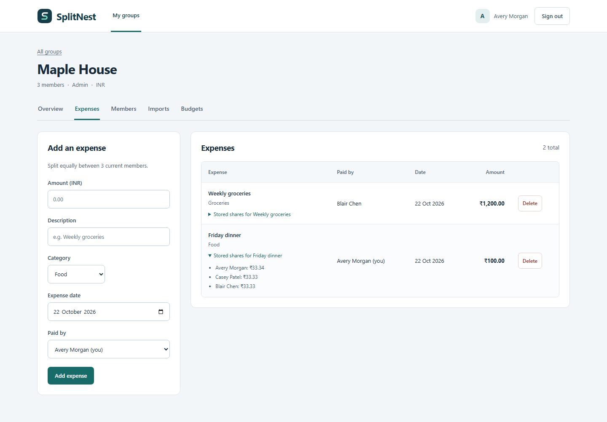
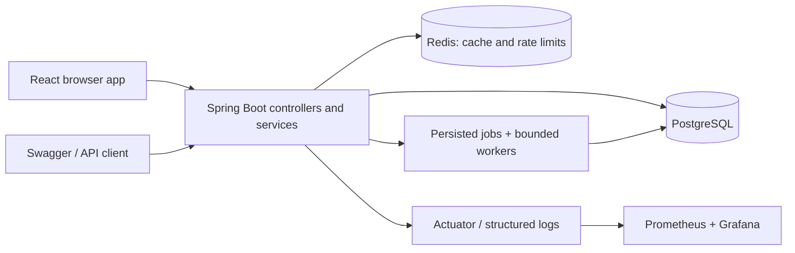

# SplitNest

A full-stack expense-sharing application for households and travel groups.
Record expenses, split costs exactly, import statement files and see what
each person owes. React and TypeScript provide the interface; Java 21 and
Spring Boot handle authentication, permissions and financial records.

[User guide](docs/user-guide.md) · [Setup](docs/setup.md) ·
[Architecture](docs/architecture.md) · [Documentation](docs/README.md) ·
[CI](https://github.com/Aadyant-7/splitnest/actions/workflows/ci.yml)



## Features

- Register and sign in; secure browser sessions use memory-only access tokens,
  rotating HttpOnly refresh cookies and CSRF protection.
- Create groups, add registered members and enforce admin/member permissions.
- Record INR expenses with exact equal splits, saved individual shares and
  balances that retain former members' financial history.
- Import CSV/XLSX statements with background processing, keyword categories,
  validation counts and durable job status.
- Set monthly category budgets and view scheduled overspending alerts.
- Shared Redis login/upload limits and balance caching; PostgreSQL remains
  authoritative for accounts and financial records.
- Docker Compose, local Kubernetes, automated CI/GitOps delivery and a
  Prometheus/Grafana dashboard with reproducible load-test scripts.

SplitNest records shared expenses; it does not transfer money or synchronize
bank accounts. It runs locally without paid services. Supported workflows and
limits are explained in the [user guide](docs/user-guide.md).

## Run locally

Requirements: Docker with Linux containers and Docker Compose. The commands
below use PowerShell; [setup](docs/setup.md) also covers other environments.

```powershell
git clone https://github.com/Aadyant-7/splitnest.git
cd splitnest
.\scripts\Initialize-Local.ps1
docker compose up --build -d --wait --wait-timeout 300
.\scripts\Smoke-Test.ps1
```

The initializer creates an ignored `.env` with random local credentials and
preserves an existing file. Alternatively copy `.env.example` to `.env` and
replace its placeholders before starting Compose.

- [Application](http://127.0.0.1:8080/)
- [Swagger UI](http://127.0.0.1:8080/swagger-ui/index.html)
- [Readiness](http://127.0.0.1:9090/actuator/health/readiness)

Create an account in the app, create a group and add other registered users.
[The demo walkthrough](docs/demo.md) covers a complete three-person scenario.
All Compose ports bind to loopback. `docker compose down` preserves the named
PostgreSQL volume; removing that volume deletes local data.

## Architecture



One deployable application, organized by feature. Controllers handle HTTP;
services enforce permissions and transactions; repositories access the data.
The frontend is compiled into the Spring Boot image, so Node is needed only
for development/builds. [Architecture and decisions](docs/architecture.md).

## Develop and test

Use JDK 21 and a running Docker engine. The Maven wrapper supplies Maven.

```powershell
.\mvnw.cmd verify
docker compose stop app
.\scripts\Start-Local.ps1
```

In another terminal, with Node 24.22.0 and npm 11.19.1:

```powershell
cd frontend
npm ci --ignore-scripts
npm test
npm run build
npm run dev
```

Vite serves [127.0.0.1:5173](http://127.0.0.1:5173/) and proxies API requests
to port 8080. [Frontend instructions](frontend/README.md) cover browser tests,
session behavior and the source layout. On Linux, use `./mvnw verify`.

Tests cover authentication and refresh replay, group isolation, monetary
invariants, transactions, imports/recovery, Redis behavior, scheduler locking,
browser sessions and real API workflows. Dated counts, image scans, CI and
rollout results are in the [verification record](docs/evidence/verification.md).

## Delivery and operations

GitHub Actions verifies the app, builds a non-root Java image, rejects CRITICAL
findings with Trivy and publishes to GHCR. The promotion job updates generated
manifests on `deploy/local`; Argo CD reconciles that branch into the local
kind cluster. Images are selected by immutable digest with source provenance.

- [Docker/Compose](docs/docker.md)
- [Kubernetes and local cluster](docs/kubernetes.md)
- [GitOps and rollback](docs/gitops.md)
- [Operations, persistence and recovery](docs/operations.md)
- [Monitoring](docs/monitoring.md) and [measured performance](docs/performance.md)

The local deployment has a single PostgreSQL instance. Persistent storage
survives ordinary Pod/container replacement but is not a backup or high
availability strategy. Performance observations are bounded local measurements.

## Repository map

| Path | Contents |
|---|---|
| `src/main/` | Java features, application configuration and Flyway migrations |
| `src/test/` | Unit/integration tests and statement fixtures |
| [frontend/](frontend/README.md) | React source, styles, component and browser tests |
| `deploy/` | kind, Kubernetes/Kustomize, Argo CD and monitoring configuration |
| `scripts/` | Setup, smoke tests, manifest validation and GitOps helpers |
| `loadtest/` | k6 workloads and cluster Job templates |
| [docs/](docs/README.md) | User/developer guides, decisions, runbooks and evidence |

See the [source map](docs/implementation.md) for the main files and their
responsibilities. Credentials, generated artifacts and private notes are
excluded from Git and the Docker build context.
