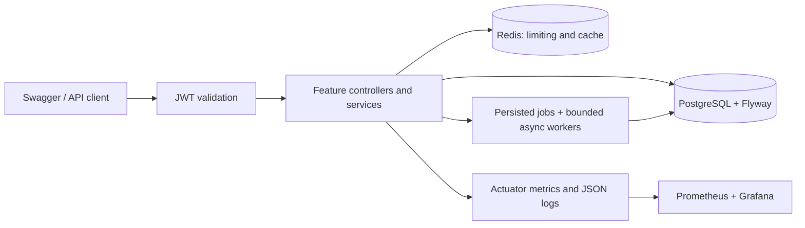
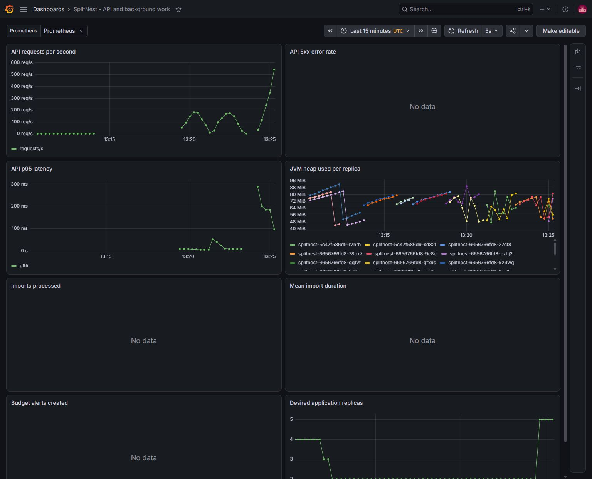

# SplitNest

An academic expense-sharing project for flatmates, families, and travel groups.
Its Java 21/Spring Boot backend combines exact financial arithmetic and group
access isolation with background processing and a local Kubernetes delivery lab.
A React/TypeScript browser interface is approved as the next implementation phase.

**Status:** original backend/local scope **100% verified**; frontend **0% implemented**.
Current interaction uses Swagger UI. The target is a polished, free local demo
for learning and placement interviews. Public hosting and commercial operation
are outside this project's scope. See the [project status](docs/project-status.md),
[documentation index](docs/README.md), and [approved frontend plan](docs/frontend-extension-plan.md).

**Verified:** 75 Java tests with real PostgreSQL/Redis containers, 20 script
scenarios, Compose and Kubernetes API smoke tests, Pod recovery, Git rollback and
restoration, and separate cache/autoscaling experiments. [GitHub CI](https://github.com/Aadyant-7/splitnest/actions/workflows/ci.yml)
passed verification, image scanning, public GHCR publication and deployment-branch
generation. Argo CD reconciled the published image with Healthy/Synced status.
See the [verification record](docs/evidence/verification.md) for evidence.

## Implemented backend features

- Registration, BCrypt passwords, 15-minute HS256 access JWTs, rotating refresh
  token families with replay detection, and ownership-checked logout.
- Group administration and reusable membership checks. Outsiders receive 404;
  current members without admin privileges receive 403.
- INR expenses split in integer paise with deterministic remainder allocation.
  Expense/split writes are atomic; SQL aggregates retain former members' history.
- Redis fixed-window login/upload limits and a thirty-second balance cache,
  with authorization before cache lookup and invalidation after commit.
- Bounded CSV/XLSX imports with keyword categorization, invalid-row counts,
  persistent job state, atomic claims and crash/rejection recovery.
- Monthly category budgets, conflict-safe daily alerts, and database-backed
  ShedLock coordination across replicas.
- Structured logs, Prometheus metrics, a Grafana dashboard and k6 workloads.
  The GitOps promotion/rollback generator has eight passing local Git fixtures;
  those fixtures do not establish a successful remote deployment.

## Current architecture



One application, organized by feature: Controller -> Service -> Repository.
JPA manages user/token entities; explicit Spring JDBC repositories handle
financial aggregates and atomic job operations within the same transaction
manager. [Architecture and flows](docs/architecture.md).

The approved extension will place feature-organized React source in `frontend/`
and package its compiled assets inside the same Spring Boot application image.
The existing Maven root, Java source, deployment topology and business rules stay
in place. Browser authentication will receive its own cookie/CSRF integration
and tests. This target architecture is documented; it is not deployed yet.

## Repository map

| Location | Responsibility |
|---|---|
| `src/main/` | Java features, configuration and Flyway migrations |
| `src/test/` | Java unit/integration tests and statement fixtures |
| [frontend/](frontend/README.md) | Approved browser app; preparation notes only at present |
| `deploy/` | Local kind, Kustomize, Argo CD and monitoring configuration |
| `scripts/` | Setup, smoke checks, manifest validation and GitOps helpers |
| `loadtest/` | k6 workloads and local-cluster job definitions |
| [docs/](docs/README.md) | Plans, explanations, runbooks, decisions and verification evidence |

## Run with Docker Compose

Requirements: Docker Desktop using Linux containers. Java 21 is also needed
for host-side Maven verification or IDE development. PostgreSQL uses host port
5433 to avoid colliding with an existing local installation.

From PowerShell in the project directory:

```powershell
.\scripts\Initialize-Local.ps1
docker compose up --build -d --wait --wait-timeout 300
.\scripts\Smoke-Test.ps1
```

Initialize-Local creates an ignored `.env` with random credentials; it preserves
an existing file. Alternatively fill `.env.example` and save it as `.env`.
Never commit that file or real tokens.

- Swagger: [127.0.0.1:8080/swagger-ui/index.html](http://127.0.0.1:8080/swagger-ui/index.html)
- Readiness: [127.0.0.1:9090/actuator/health/readiness](http://127.0.0.1:9090/actuator/health/readiness)
- Metrics: [127.0.0.1:9090/actuator/prometheus](http://127.0.0.1:9090/actuator/prometheus)

Register and log in through Swagger, copy `accessToken`, then select Authorize
and enter the token. The [demo guide](docs/demo.md) walks through the complete
scenario. All exposed Compose ports bind to loopback.

```powershell
docker compose logs -f app
docker compose down
```

The named PostgreSQL volume is preserved by `down`. Deleting volumes destroys
local data; volume persistence is not a backup strategy.

## Develop and test

The committed Maven wrapper downloads the selected Maven distribution; no global
Maven installation is required. Docker must be running for integration tests.

```powershell
.\mvnw.cmd verify
docker compose stop app
.\scripts\Start-Local.ps1
```

On Linux/CI: `./mvnw verify`. Tests cover monetary invariants, cross-group access,
refresh replay/concurrency, rollback, caching, limiter races, parser resource
limits, import recovery, scheduler locking and observable metrics.

The separate GitOps fixture suite uses Bash and temporary local Git repositories:

```bash
bash scripts/test-promotion.sh
```

Load-data preparation has its own PowerShell fixture suite, which contacts no
real API or cluster:

```powershell
.\scripts\Test-PrepareLoadTest.ps1
```

## Delivery and operations

The configured GitHub Actions workflow verifies every pull request and main
push. Its publication job builds a non-root Java 21 image, rejects CRITICAL
vulnerabilities with Trivy, and publishes the scanned image with a source-SHA
tag. A separate job validates generated manifests and fast-forwards `deploy/local`;
the Argo Application is configured to watch that branch. Image promotion commits
can be reverted separately from manifest changes. Successful remote runs and
reconciliation are tracked in the verification record.

The initial image scan rejected Boot's Tomcat 11.0.24 dependency. The POM now
uses Tomcat 11.0.27 within the same major version, and all 75 tests pass with that
override. The rebuilt local image also passed Trivy with zero CRITICAL findings.
The remote CI gate also passed. A passing scan or tests alone do not establish
a successful deployment; the verification record tracks runtime reconciliation.

- [Dockerfile, layers, Compose and image verification](docs/docker.md)
- [Operations: health, secrets, migrations, recovery and backup limitations](docs/operations.md)
- [kind, Kubernetes objects, secrets, probes, HPA and failure exercises](docs/kubernetes.md)
- [Argo CD setup and GitOps workflow](docs/gitops.md)
- [Promotion safeguards, tests and rollback](docs/gitops-promotion.md)
- [Prometheus/Grafana setup and controlled k6 experiments](docs/monitoring.md)
- [Measured cache comparison and autoscaling results](docs/performance.md)

During the separate 50-user local load test, the HPA moved from two to five ready
replicas. The fixed-replica cache comparison measured p95 of 7.26 ms cached and
9.94 ms uncached; these are bounded local observations, not production capacity.



The default kind configuration prefers cgroup v2. Docker engines reporting
cgroup v1 need the explicitly documented local compatibility configuration.
Database credentials and JWT keys are created outside Git. GHCR packages must
be publicly pullable or use an image pull secret.

## Learn and explain the project

- [Learning sequence after the full app is complete](docs/learning-roadmap.md)
- [Implementation: file-by-file reading guide](docs/implementation.md)
- [Concepts from beginner to advanced](docs/learning-guide.md)
- [Architecture decisions](docs/decisions/0001-modular-monolith.md)
- [Twenty interview questions](docs/interview-prep.md)
- [Development plan and acceptance gates](docs/development-plan.md)
- [Windows setup](docs/setup.md)

Scope is deliberately one currency and one application. Cached balances have
bounded eventual consistency; logout does not immediately invalidate access JWTs.
The local cluster uses a single PostgreSQL instance and is not a highly available
production environment. Current limits and measured evidence are documented
alongside the implementation.

Implementation comes first, followed by verification of the complete browser app,
then a guided explanation from requirements and data design through each major
implementation and deployment decision. Documentation is maintained throughout;
the detailed learning phase does not interrupt each build milestone.

## Resume summary

Built a Java 21/Spring Boot expense-sharing API with PostgreSQL transactions,
JWT security, Redis caching/rate limiting and asynchronous statement imports;
automated testing, image scanning and local Kubernetes delivery using GitHub
Actions, Argo CD and Prometheus/Grafana.
