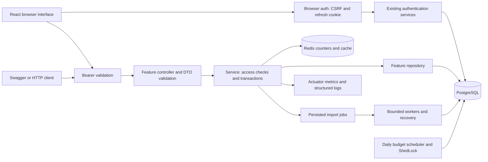
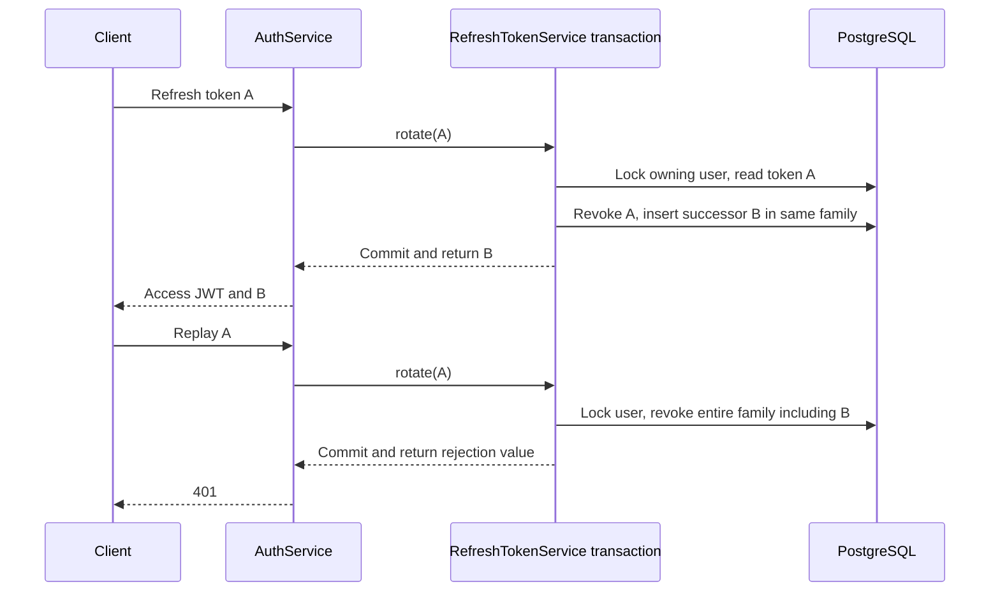
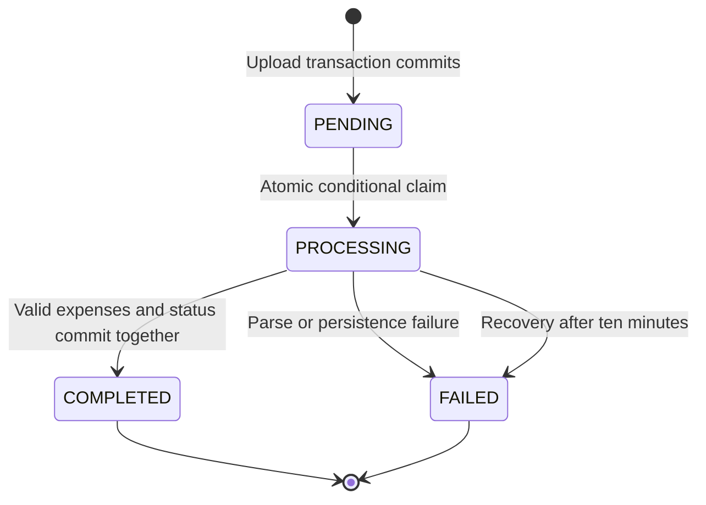

# How SplitNest works

Navigation: [documentation index](README.md) · [project status](project-status.md) ·
[approved frontend plan](frontend-extension-plan.md).

SplitNest is one Java 21/Spring Boot application organized by feature. PostgreSQL
stores the business records. Redis holds short-lived balance results and shared
request counters. A React/TypeScript interface now uses the real API for account,
group, expense, import and budget workflows. Swagger and HTTP clients retain the
existing JSON-token API. All amounts represent INR; this version has no currency
conversion.

The project is a free, local academic and placement demonstration. The application,
data stores, Kubernetes cluster and monitoring run on the owner's machine; paid
hosting, public deployment and cloud infrastructure are outside the agreed scope.

Read [implementation.md](implementation.md) beside the code, then follow
[demo.md](demo.md). The [decision records](decisions/0001-modular-monolith.md)
explain the tradeoffs. Deployment files describe a reproducible local target;
runtime and CI claims belong in the verification evidence, not this diagram.
The diagram describes the implemented source. Combined-image deployment evidence
is tracked separately in [project status](project-status.md).

## Browser interface and runtime boundary

[App.tsx](../frontend/src/app/App.tsx) defines account screens, the authenticated
shell, group list and group workspace. Feature panels display expenses, stored
balances, members, statement-job results, category limits and alert snapshots.
Java remains responsible for authorization, exact amounts, transactions and jobs.
Form amounts travel as decimal text. The API keeps its numeric JSON contract;
the browser parser preserves original monetary tokens as decimal strings before
JavaScript Number rounding, and modern `Intl.NumberFormat` formats them exactly.
The browser never calculates authoritative expense splits.

During development Vite serves port 5173 and proxies `/api` to the JVM on 8080.
The Dockerfile builds static assets with Node 24.22.0/npm 11.19.1, copies them into
Spring Boot's resources and packages one Java image. Node is build/test tooling;
the final runtime is the existing non-root JRE container. CI source includes the
frontend build, component tests and packaged-app Chromium workflows. The GitOps
source profile includes frontend source/configuration/lockfiles, so a UI-only
change counts as an application release. These files and eleven local promotion
fixtures are verified; the [runtime record](evidence/frontend-gitops.json) also
proves an automatic combined-image rollout after an actual frontend-only change.

`SpaRoutes` and `SpaController` allow `/`, `/login`, `/register`, `/app`,
`/app/groups` and `/app/groups/{UUID}`. Spring serves `/index.html`, `/assets/**`
and the explicit favicon paths. An unknown API, actuator or asset path retains
its HTTP error; there is no catch-all HTML response. The UI's content security
policy permits bundled same-origin scripts/styles and avoids inline script/eval.
Swagger retains its own compatible response policy.

### Browser authentication

The adapter adds four routes beneath `/api/v1/browser-auth`:

| Operation | Contract |
|---|---|
| `GET /csrf` | Returns a masked `{token, headerName}` and initializes a host-only HttpOnly CSRF cookie, without an HTTP session. |
| `POST /login` | Existing login body plus CSRF cookie/header; same email/IP Redis limit; access-only JSON and refresh cookie. |
| `POST /refresh` | CSRF plus refresh cookie; rotates the existing token family and returns access-only JSON with the successor cookie. |
| `POST /logout` | Valid access bearer, CSRF and owned refresh cookie; revokes its family and clears the cookie. |

The refresh cookie is `splitnest_refresh`, HttpOnly, host-only, SameSite=Strict,
scoped to `/api/v1/browser-auth`, and valid for seven days. Secure defaults to
true; `BROWSER_COOKIE_SECURE=false` is explicitly set by local HTTP Compose,
kind configuration and the host launcher. A dedicated standard Spring Security
CSRF filter protects every unsafe browser-auth method, even when it carries a
bearer token. Existing bearer API routes remain CSRF-exempt. This explicit filter
avoids the resource-server DSL's normal bearer exemption weakening cookie routes.

[session.ts](../frontend/src/app/session.ts) holds the access token only in module
memory. It obtains CSRF immediately before each browser-auth POST while holding
the `splitnest-browser-session` Web Lock. One promise coalesces refresh requests
within a tab; the shared browser lock serializes cookie rotation across tabs.
Login/refresh use the public client without a stale Authorization header. Logout
can refresh its bearer directly inside the existing lock, avoiding a nested-lock
deadlock. A browser without Web Locks shows an explicit coordination error.

BroadcastChannel carries only `changed`/`signed-out` notifications. It never
transmits credentials or tokens. A generation counter invalidates old requests:
a delayed `/users/me` response cannot restore a user after logout/account change,
and a cookie-change notification waits for an invalidated refresh to settle before
starting another. The API client retries an authentication-rejected request once,
preserving its JSON/FormData body and cancellation signal; it discards responses
from an older account generation. The browser owns multipart boundaries.

On confirmed refresh 401, the adapter clears the unusable cookie. A temporary
server failure preserves it for retry. Logout clears after successful revocation
or confirmed 401; a mismatched owner 403 leaves the real owner's cookie intact.
No auth token is stored in localStorage or sessionStorage. Imports remember only
a validated, non-secret job UUID in per-tab sessionStorage, keyed by user/group.
The backend still checks membership on every status request. Panel lifecycles
abort old requests when the account/group changes.

Strict frontend builds, Java verification and browser workflows have passed.
The temporary host test server was stopped to release its Windows JAR lock;
complete Maven verification and packaging now succeed. Consult
[project status](project-status.md) and the [verification ledger](evidence/verification.md)
for current counts and image/deployment evidence. The guided learning phase
begins after full-app verification, when the owner is ready.

Understanding checks:

1. Why does an HttpOnly refresh cookie require CSRF protection while the bearer API remains exempt?
2. Why does a shared cookie require both a per-tab promise and a browser-wide lock?
3. How does the generation check prevent a delayed response reviving the wrong account?

## Follow one request

Browser CSRF protection uses Spring Security's `PathPatternRequestMatcher`, which
matches decoded paths consistently with MVC. A raw `getRequestURI().startsWith`
check was found to miss encoded characters such as `%2d` in `browser-auth` even
though MVC still selected the controller. The regression test covers normal and
encoded login/refresh/logout paths; raw HTTP probes must return 403 without CSRF.
See [Spring Security's MVC matching guidance](https://docs.spring.io/spring-security/reference/servlet/integrations/mvc.html).

A controller translates HTTP into a service call. Request records carry validation
rules; response records expose only the fields clients need. Services enforce
business permissions and transaction boundaries. Repositories contain database
queries. A controller never calls a repository directly.

For `POST /api/v1/groups/{groupId}/expenses`, Spring Security first verifies the
bearer signature and claims. `CurrentUser` obtains the UUID from its subject.
`ExpenseService` locks the group's database row, rechecks membership, validates
the payer and amount, captures the current roster, and saves the expense and
every split in one transaction. Only a committed write causes cache eviction.

Authentication answers who is calling. Authorization answers whether that person
can perform this action. `GroupAccessService` centralizes membership/admin rules.
An outsider receives 404 so the API does not disclose group existence. A current
member attempting an admin operation receives 403. Nested expense/import queries
include both group ID and resource ID, preventing a valid child ID from bypassing
its parent group's checks.

`GlobalExceptionHandler` returns `ProblemDetail` responses, including field-level
validation messages. Security filter errors use the same response shape because
they happen before MVC controller advice can handle them. Unexpected responses
contain a generic explanation rather than a stack trace.

Understanding checks:

1. Why is checking membership only in a controller insufficient for imported expenses?
2. Why does an authenticated outsider receive 404 while a member can receive 403?
3. Which transaction prevents an expense being saved without all of its splits?

## Registration, JWTs and refresh families

Registration trims and lowercases email addresses before validation. PostgreSQL's
unique constraint settles concurrent registrations; a preflight lookup alone
could let both requests pass. Passwords use BCrypt with cost 12. Validation checks
at least eight Unicode code points and at most 72 UTF-8 bytes, avoiding BCrypt's
input limit being confused with a character count. Responses never include hashes.

Login returns a signed HS256 access JWT valid for fifteen minutes and a separate
opaque refresh token valid for seven days. The JWT contains subject UUID, issuer,
audience, issue/expiry times and a token ID. It contains no password or bank data.
A signature protects integrity; the JWT payload is readable and is not encrypted.
The decoder checks signature, issuer, audience, required expiry and UUID subject.
The signing key must come from `JWT_SECRET`, as Base64 encoding of at least 32
random bytes. Base64 itself provides no secrecy.

Stateless authentication means each request carries its access proof rather than
depending on a server-side HTTP session. PostgreSQL still stores refresh-token
state. Only SHA-256 hashes of cryptographically random refresh tokens are saved;
hashing is appropriate here because the original values already have high entropy.
Human passwords need a deliberately expensive password hash such as BCrypt.

Returning a rejection value from the transactional service is deliberate: throwing
the HTTP rejection inside that transaction could roll back the family revocation.
The owning user-row lock serializes refresh and logout changes, including races
between replay of an ancestor and rotation of its successor. Clients must serialize
refresh calls: simultaneous use of one token triggers the same replay policy.

Logout checks that the JWT user owns the supplied refresh token and revokes its
family, including when an old family token is supplied. Other login families remain
valid. Existing access JWTs remain usable until their fifteen-minute expiry.

Understanding checks:

1. Why use BCrypt for passwords and SHA-256 for random refresh tokens?
2. Why must replay revocation commit before the API throws its 401 exception?
3. Why can a request still succeed with its access JWT immediately after logout?

## Exact money, membership history and SQL balances

`BigDecimal` and PostgreSQL `NUMERIC(12,2)` represent amounts exactly. Expenses must
be positive, have at most two decimal places and fit the storage range. Calendar
dates use years 0001–9999. Timestamps use `Instant`/`TIMESTAMPTZ`; an expense's
business date is a separate `LocalDate`/`DATE`.

`EqualSplitCalculator` converts an amount to integer paise, divides it, sorts
members by canonical UUID text, and distributes remaining paise in that order.
For 100.00 and three members, the shares are 33.34, 33.33 and 33.33. Java's default
UUID comparison uses signed components, so the explicit text ordering matters.

Membership and financial mutations take the same group-row lock. A concurrent
member removal and expense insertion therefore agree on one ordered roster.
Historical split rows are snapshots: joining or leaving never rewrites them.
Removing a member removes access and current membership, while preserving amounts
they paid or owe. Balances include former participants with `currentMember: false`.
Removing the last admin is rejected inside the locked transaction.

The balance SQL uses common table expressions (named intermediate queries):

| CTE | Result |
|---|---|
| `paid` | Sum expenses once per payer for the group. |
| `shared` | Sum stored splits once per participant for the group. |
| `participants` | Union current members with anyone having a payment or split. |
| Final query | Join users and the two aggregates; compute paid minus share. |

Aggregating separately avoids multiplying payments by the number of joined split
rows. PostgreSQL computes the totals without Java loading all expenses. Since each
expense's splits equal its amount, all participants' net balances sum to zero.

Authentication entities use JPA. Group, expense, import and budget repositories
use `JdbcClient` for explicit SQL. They share the same DataSource and Spring's
JPA transaction manager, which exposes the transaction's JDBC connection. Therefore
the JDBC statements inside `@Transactional` service calls commit or roll back
together. Transaction rollback tests exercise this with real PostgreSQL; JDBC is
not a separate database session merely because its repository uses a different API.

Understanding checks:

1. What goes wrong if raw payments and raw splits are joined before aggregation?
2. Why should removing a member preserve their split rows?
3. Why do membership changes and expense writes lock the same group row?

## Redis: authorization, caching and rate limiting

`BalanceService` checks membership before calling the separate `BalanceCalculator`
bean. That call crosses Spring's cache proxy, allowing `@Cacheable` to intercept it.
Putting both steps in one cached method could let a hit bypass authorization.
Calling an annotated method through `this` would bypass the proxy.

Balance entries have a thirty-second TTL. Expense creation/deletion, committed
imports and membership changes publish `ExpenseChanged`; an `AFTER_COMMIT` listener
evicts the affected group. Redis failures during cache operations fall back to
PostgreSQL. Caching can be disabled with `splitnest.cache.enabled=false` for a
controlled comparison.

This cache provides bounded eventual consistency. A reader can fetch old database
state, a writer can commit and evict, then the reader can fill the cache with its
old result. That value expires after thirty seconds from insertion unless another
mutation evicts it sooner. Database financial writes remain authoritative; cache
reads do not promise a single globally ordered view. Authorization is always checked
afresh, including when a removed member's old balance remains in a cached value.

The rate limiter uses fixed UTC epoch-minute/hour buckets. One Redis Lua execution
performs `INCR`, sets initial expiry, and returns the remaining TTL if over the limit.
Combining these operations prevents a crash between increment and expiry leaving
an immortal counter. Login permits five requests per minute for normalized email
plus actual client IP; imports permit ten per hour per user. Identity components
are hashed in Redis keys. Arbitrary forwarded-IP headers are not trusted.

Excess requests receive 429 and `Retry-After`. If Redis cannot enforce the limit,
login/uploads return 503. Balance caching can safely degrade because PostgreSQL
can recompute a value; allowing unlimited login attempts would change the security
policy. Fixed windows allow bursts around a boundary. A token bucket could smooth
those bursts but is outside this implementation.

Understanding checks:

1. Why does a cache hit still need a database membership check?
2. Can eviction after commit alone prevent every stale-cache race?
3. Why are cache failures tolerated while limiter failures reject the operation?

## Durable background imports

The upload transaction stores file bytes and a `PENDING` job before returning 202.
An after-commit event submits a fast-path async worker. If the process crashes
between commit and event handling, or the executor rejects submission, the database
row survives. A dispatcher checks pending rows every fifteen seconds.

`UPDATE ... WHERE status='PENDING' RETURNING ...` permits one worker to claim a
job across event and dispatcher paths or multiple app replicas. Parsing occurs
outside a long database transaction. Completion starts a new transaction, locks
the job row, verifies it is still `PROCESSING`, then saves all valid expenses and
the terminal status together. The group lock provides one current roster for the
whole statement; uploader membership is rechecked before persistence.

Recovery runs on startup and every sixty seconds. It fails jobs whose `started_at`
is over ten minutes old. If recovery wins while a worker parses, the worker later
sees `FAILED` under the job lock and cannot persist expenses. If final persistence
holds the lock first, recovery waits and rechecks the committed status. Failed jobs
are not automatically retried; the user uploads again. Terminal jobs clear file
bytes while retaining status and counts.

| Bound | Implemented limit |
|---|---|
| Upload | CSV or XLSX, at most 5 MiB; multipart envelope at most 6 MiB. |
| Executor | Two core threads, at most four threads, queue of sixteen. |
| Rows | At most 10,000, configurable downward. |
| XLSX archive | At most 1,000 entries and 32 MiB total expansion by default. |
| Worksheet | Exactly one sheet; at most sixteen columns per inspected row. |
| XML preflight | Streaming StAX checks depth, element/cell counts, text, styles and shared strings before POI builds workbook objects; DTDs/entities/external relationships are rejected. |
| Numeric conversion | Raw numeric length/precision/scale bounded before decimal expansion. |
| Unsafe workbook content | External links/macros rejected; formula rows are skipped without evaluation. |

CSV is UTF-8, optionally with a BOM. Both parsers require `date`, `description`
and `amount` headers. Text dates are `yyyy-MM-dd`, years 0001–9999. CSV amounts use
positive plain decimals with at most two fractional digits, without currency signs,
thousands separators or scientific notation. Numeric XLSX values are handled as
bounded exact decimal text. Invalid rows are counted and skipped. Unreadable files
or files with no valid rows fail with a sanitized explanation. Keyword rules in
configuration choose categories in deterministic enum order.

Understanding checks:

1. Why is `@Async` alone insufficient to guarantee a committed upload gets processed?
2. Why does recovery check `started_at` and completion lock the job row?
3. What prevents half of an imported statement being committed after a later row fails?

## Budgets, observability and deployment

The budget job runs daily at 00:00 UTC and sums `expense_date` values in the current
UTC month. Spending must be strictly greater than the limit. A unique
group/category/month key plus `ON CONFLICT DO NOTHING` prevents duplicate alerts.
An alert records a snapshot at first detection rather than an always-changing total.

Each alert's `spent` column follows the original `NUMERIC(12,2)` model. A month's
sum can exceed that range even when each expense fits. The current implementation
logs an explicit range error and skips that oversized snapshot instead of clamping
the value or failing all other alerts. This is a documented limitation; wider alert
snapshot storage would need an intentional schema change.

ShedLock uses the database clock and a shared `shedlock` row for the budget job,
with a ten-minute maximum lock and one-second minimum hold. Another scheduler skips
when the lock is held. The maximum bounds crash recovery; it is not a guarantee
that an arbitrarily long job cannot outlive its lock. The unique constraint still
protects alert insertion. Every pooled JDBC session initializes its timezone to
UTC. This matters because ShedLock's database-time SQL uses UTC wall-clock values:
interpreting them in a non-UTC session when assigning `TIMESTAMPTZ` would shift the
stored instant. Import row claims remain necessary independently.

Actuator uses management port 9090; the API uses 8080. Readiness includes PostgreSQL
and excludes Redis to permit degraded balance reads. Liveness checks the process.
Prometheus exports HTTP/JVM metrics, processed-import counters, import-duration
histograms and created-alert counters. The exported names include
`splitnest_imports_processed_total`, `splitnest_imports_duration_seconds_bucket`
and `splitnest_budget_alerts_total`; the alert meter is named
`splitnest.budget.alerts` to avoid Prometheus's reserved `.created` suffix.
Metric labels use bounded status values,
not user/group IDs. The request filter adds path/user/group context to ECS JSON
logs and clears MDC keys even when a request fails. It never reads/logs bodies,
passwords, bearer tokens or statement contents.

The container runs as UID 10001 using a JRE stage, a read-only filesystem and bounded
writable temporary space. Compose supplies PostgreSQL and Redis. The Kubernetes
target adds two app replicas, Services, probes, resource requests/limits and an
HPA, while PostgreSQL uses a StatefulSet/PVC. GitHub Actions verifies and scans
before publishing SHA-tagged images. The GitOps design uses a generated
`deploy/local` branch watched by Argo CD; see [gitops.md](gitops.md) for promotion
and rollback details and their current verification state.

Understanding checks:

1. Why have both ShedLock and a unique alert constraint?
2. Why must database availability affect readiness rather than liveness?
3. Why does reverting a container image not reverse a Flyway migration?
