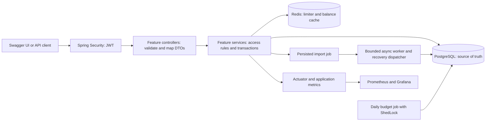

# SplitNest execution plan

Reviewed: 18 October 2026. This is the current execution plan. The original
feature specification and numbered learning tasks remain in `agents.md`.
Verification status updated: 19 October 2026 (India).

Current scope: the backend and local delivery baseline below are verified. The
owner has approved the React browser extension for a free local academic and
placement demonstration. Frontend milestones 1–5 are implemented and verified
(**83%**); combined-image CI/GitOps delivery verification is in progress.
Use the [documentation index](README.md) and [project status](project-status.md)
to distinguish the completed baseline from the approved work still ahead.

## 1. Review outcome

The initial repository contained only `agents.md`. There was no source code,
build file, Maven wrapper, Docker configuration, or Git repository to preserve.
That review began a new backend implementation, which is now complete and
verified. The browser extension is a later, explicitly approved stage.

The implemented modular monolith remains appropriate: one deployable application with
packages for auth, users, groups, expenses, budgets, imports, and rate limiting.
Its strongest interview material will be financial correctness, authorization,
transactions, background-job reliability, and reproducible delivery.

Keep all the original business features. The owner's approval supersedes the
original no-frontend exclusion for the React interface described in
[frontend-extension-plan.md](frontend-extension-plan.md) and
[ADR 0007](decisions/0007-browser-frontend.md). Microservices, message brokers,
cloud deployment, paid hosting, Terraform, unequal splits, invitation emails and
settlement optimization remain outside scope. The app will be demonstrated
locally; a public hosted service is not part of this project stage.

Execute six milestones rather than pausing at every original task. Start CI
early, implement tests with behavior, and update explanations alongside code.
The milestones are execution order and acceptance gates, not requests for
repeated permission. Setup and GitHub instructions are collected in
[setup.md](setup.md).

The six milestones below describe the completed backend work. Section 11 defines
the approved browser extension without resetting that evidence. A detailed
from-scratch learning phase starts after the complete browser application has
been implemented and verified; the [learning roadmap](learning-roadmap.md)
defines that later teaching order.

## 2. Environment and baseline

Initial planning observations are retained below as history. They do not describe
the current installed tools: Java 21, Docker, the wrapper and the local kind
cluster are now verified. See the [current verification record](evidence/verification.md).

| Item | Observation | Consequence |
|---|---|---|
| Git | 2.53.0.windows.2 available | Local version control can be initialized later |
| Java | Direct JDK executable reports 23.0.2; JAVA_HOME points to JDK 23 | Install/select JDK 21 to match development, CI, and containers |
| IDE | VS Code installation found | Can use the existing IDE |
| Maven | Not found on PATH | Generate and commit Maven wrapper scripts |
| Docker | CLI not found on PATH or in checked install directories | Docker Desktop setup is needed for integration tests and deployments |
| Kubernetes tooling | kubectl, kind, Helm not found on PATH | Install before the Kubernetes milestone |
| Other tooling | gh and k6 not found on PATH | gh is optional; k6 can run in a container |
| PostgreSQL | Version 18 client binaries found | Does not establish server health; avoid assuming port 5432 is free |
| GitHub | No local repository or remote configured | Owner creates repository; authenticate through normal Git tools |

These observations are not a complete inventory of every installation on the
computer. Missing PATH entries are reported as observations, not proof that a
program cannot exist elsewhere. No installers or global settings were changed.

### Version decisions

The live [Spring Initializr metadata](https://start.spring.io/metadata/client)
returned `4.1.1.RELEASE` as its default stable Boot version during this review;
its Java choices included 21. Spring Boot 4.1.1 is the implemented stable
baseline. Artifact resolution, tests and application startup have succeeded.

Retain Java 21. The [Boot system requirements](https://docs.spring.io/spring-boot/system-requirements.html)
support this choice. Prefer Boot's dependency management over manually pinning
every transitive library.

The initial Trivy image scan found three CRITICAL-rated vulnerabilities in the
Boot-managed Tomcat 11.0.24. `pom.xml` now deliberately overrides
`tomcat.version` to 11.0.27, staying on Tomcat 11. All 75 application tests pass
with the override. The rebuilt local image independently passed Trivy with zero
CRITICAL findings. The full GitHub Actions run for `9d095d4` also passed its
independent scan, publication and promotion gates; the published digest was
retrieved anonymously. Keep the scan policy intact. Review the override when a later Boot release manages a patched
version, then remove it only after verifying the resolved dependency and tests.
See [Apache's Tomcat 11 security record](https://tomcat.apache.org/security-11.html).

The original JUnit 5 wording needs an update. Use the JUnit Jupiter test support
managed by Boot 4.1, whose current testing documentation describes JUnit 6.
This is a version update within the existing test stack, not an additional
testing framework. See [Boot testing](https://docs.spring.io/spring-boot/reference/testing/index.html).

The implementation uses springdoc's Boot 4 generation, version 3.1.1, from its
[current documentation](https://springdoc.org/). Its published matrix explicitly
lists Boot 4.0 with springdoc 3.0; a Boot 4.1.1 + springdoc 3.1.1 smoke test is
now passed: tests exercise the bearer scheme, and the running Compose app returns
Swagger and its OpenAPI definition successfully.

Use Spring's `ProblemDetail` with the current Problem Details standard,
[RFC 9457](https://www.rfc-editor.org/rfc/rfc9457.html), which supersedes the
plan's RFC 7807 reference. The error-response intent stays the same.

Resolve and pin remaining container tags, Helm charts, external library
versions, and CI action revisions when their milestones begin. Record the
selected versions and verification result; do not silently switch technologies
to make a build pass. Approved dependencies and container images are now pinned
in pom.xml, Dockerfile and deployment files.

## 3. Implemented application architecture

This diagram describes the verified backend. A React client is approved but does
not exist yet; its future requests will use the same services and database rules.

Each feature follows Controller -> Service -> Repository. Controllers accept
and return record DTOs. They never expose JPA entities or call repositories
directly. Shared infrastructure stays in `common`; business rules stay in their
feature packages. Use one Maven module and one application image.

PostgreSQL owns durable business state. Redis contains replaceable cached
results and shared rate-limit counters. Background work uses the existing
database and bounded executor; no message broker is needed for this scope.

The application implements these flows. The diagram alone is not evidence of a
working deployment or a measured performance result.

## 4. Implementation contracts and acceptance checks

### Money and membership

- All groups use INR in this version; there is no foreign-exchange conversion.
  State this in the API documentation so unrelated currencies cannot be mixed.
- Store money as NUMERIC(12,2), use BigDecimal, and reject nonpositive expenses,
  excess precision, and values outside the database range.
- Split integer paise. Sort members by canonical UUID text and allocate each
  remaining paisa to the next member. Document the ordering and test it.
- Capture the member roster when creating the expense. Later membership changes
  never recalculate historical splits.
- Membership changes and expense creation take the same group-row lock, giving
  concurrent operations a definite order. Check permissions again within the
  mutation transaction, including the last-admin rule.
- Removing a member removes current access, not their historical financial
  records. Balance output includes former participants with a `currentMember`
  flag, as well as current members. Former members cannot query the group.
- Calculate total paid and total share in separate SQL aggregates before joining
  them. Joining every payment to every split would multiply payment totals.
- Persist an expense and all its splits in one transaction. Deletion also removes
  its splits atomically. Every group's net balances must sum to exactly zero.

### Authentication and access control

- Lowercase/normalize emails consistently; enforce uniqueness in PostgreSQL.
- Use BCrypt and validate its input byte limit explicitly, including Unicode
  passwords. Do not silently truncate passwords.
- Issue HS256 access tokens valid for 15 minutes. Require a sufficiently strong
  secret from the environment, with no committed or built-in signing secret.
  Validate signature, expiry, issuer, and audience.
- Generate opaque refresh tokens using SecureRandom; store only SHA-256 hashes.
  Use a seven-day refresh lifetime as the initial documented policy.
- Lock and rotate refresh tokens in one transaction. Retain a token-family link
  so reuse can revoke the remaining family, rather than just rejecting the
  already-revoked row. Commit replay-triggered family revocation before returning
  401; an exception must not roll it back. Test A -> B, replay A, then rejection
  of B. Clients serialize refresh calls, because concurrent refreshes can be
  indistinguishable from replay and revoke the family.
- Logout checks ownership and revokes refresh capability. Already-issued access
  tokens remain usable until expiry; immediate access-token revocation is outside
  this version's scope.
- Apply GroupAccessService to every group operation. Outsiders receive 404;
  members attempting an admin action receive 403. Nested queries constrain both
  group ID and child-resource ID.
- Return consistent ProblemDetail responses from controller advice and Spring
  Security's filter-chain error handlers. Do not return stack traces.

### Imports and scheduled work

- Support documented UTF-8 CSV and XLSX columns: date, description, amount.
  Define accepted date/number formats and reject unsupported spreadsheet types.
- Enforce the 5 MB upload limit plus row and expanded-workbook limits. Bound
  memory and executor queues; do not evaluate spreadsheet formulas or external
  links. Include malformed and oversized fixtures in tests.
- Persist PENDING before returning 202. The after-commit async event is a fast
  dispatch path; a periodic pending-job dispatcher closes the crash/rejection
  gap. Both paths use an atomic PENDING -> PROCESSING claim.
- Add `started_at` for processing age. Recover stale PROCESSING jobs periodically
  and at startup, rather than comparing upload creation time to ten minutes.
- Parse outside a long database transaction. A separate worker service saves all
  valid rows and COMPLETED status in a fresh transaction; if persistence fails,
  none of that job's expenses are committed. Invalid rows are counted and skipped.
  A readable file with zero valid rows is FAILED with zero imported rows and a
  sanitized explanation; test this separately from an unreadable file.
- Capture one member roster for each imported statement at persistence time.
  Recheck the uploader's membership; removal before persistence fails the job.
- The final persistence transaction locks the job row and checks it is still
  PROCESSING before saving expenses and marking COMPLETED. Recovery changes stale
  jobs to FAILED; a worker that finds that status aborts its whole transaction.
  This nonretrying protocol needs no additional lease/fencing framework. Do not
  automatically retry FAILED jobs. Test recovery racing final persistence.
- Configure parsing and categorization limits and keywords in application.yml.
  Clear stored file bytes on terminal completion/failure; retain status and counts.
- Budget month boundaries and the daily schedule use UTC. An alert means spending
  is strictly greater than the limit. Keep a unique group/category/month key;
  use conflict-safe inserts rather than leaving a transaction rollback-only.
- Add ShedLock before running two app replicas. Row claiming remains necessary
  for imports even with a scheduler lock.

### Redis and operational behavior

- Implement fixed calendar-minute/hour buckets. A Redis Lua script combines
  INCR, initial expiry, and TTL lookup atomically. Return 429 and Retry-After.
- Login uses a key for normalized email plus actual client IP; uploads use user
  ID. Hash key components to avoid storing raw email addresses in Redis keys.
  Do not trust arbitrary X-Forwarded-For headers in this local deployment.
- If rate limiting cannot reach Redis, reject the affected operation with 503.
  Cache failures fall back to PostgreSQL so balances remain available.
- Check membership before any cache lookup. Evict balances after committed
  expense writes, imports, and membership changes; use a short TTL.
- Treat the cache as bounded eventual consistency. A concurrent stale fill can
  race an eviction; document and test the boundary. PostgreSQL remains the
  authority for writes and financial invariants. Do not claim the cache makes
  all reads linearizable.
- Liveness checks the app process, not database availability. Readiness includes
  PostgreSQL but excludes Redis, so the stated degraded balance-read behavior
  remains reachable through the Service. Rate-limited operations return 503
  during that Redis outage. Use startup probes for Java warm-up, graceful shutdown,
  bounded pools, and explicit resource requests/limits.
- Expose metrics through an internal management path/port. User and group IDs
  belong in structured logs, never high-cardinality metric labels.

These contracts guide the implementation and tests. The status table and evidence
ledger distinguish application tests, completed delivery checks and stated limits.

## 5. Milestones and acceptance gates

These are the original backend/local-delivery milestones. Their completion does
not claim that the approved browser extension is implemented.

| Milestone | Original task references | Deliverable | Acceptance evidence | Status |
|---|---|---|---|---|
| 1. Reproducible foundation | 0.1-0.3, 1.1, 6.1 | Wrapper, Boot project, feature packages, Compose data services, configuration, errors, initial test CI | Java 21 build; PostgreSQL/Redis connectivity; migration startup; Windows verify and Linux CI results | Verified locally and in a fresh Linux GitHub Actions checkout |
| 2. Complete financial API | 1.2-1.5, 2.1-2.4, 3.1 | Registration/login/refresh/logout, Swagger, membership, expenses, SQL balances, isolation suite | Three-user API demo; uneven splits; rollback; history after removal; 404/403 matrix; refresh replay/concurrency tests | All 75 Java tests pass locally and in CI; Compose and Kubernetes API smoke tests pass |
| 3. Reliability and background work | 3.2-3.4, 4.1-4.5, 9.1-9.2 | Limiting/cache, imports/recovery, budgets/alerts, metrics/log context, initial ADRs | Real Redis tests; file fixtures; one claim across workers; recovery of lost events; duplicate-alert prevention; secret-free logs | Automated tests pass locally and in CI; live imports and one persisted budget alert with two replicas and a ShedLock row verified |
| 4. Reproducible delivery | 5.1-5.2, 6.2 | Non-root multistage image, full Compose, scan, GHCR image publishing | Healthy Compose startup; smoke scenario; measured image size; required test job and critical-vulnerability scan pass | Verified: Compose, local and remote scans, GHCR publication and anonymous digest retrieval |
| 5. Kubernetes and GitOps | 7.1-7.6, 8.1-8.4 | kind, handwritten manifests, two replicas, ShedLock, HPA, Argo CD, promotion and rollback | Healthy rollouts; retained expenses after database replacement; persisted-alert uniqueness and observed lock; commit-to-cluster reconciliation; Git rollback; failure experiments | Verified: Pod/PostgreSQL recovery, scheduler evidence, HPA 2-to-5, and automatic Argo promotion/Git rollback/restore, each with two ready replicas and Healthy/Synced status |
| 6. Evidence and interview handoff | 9.3-9.4, 10.1-10.3 | Dashboard, controlled k6 runs, complete README/runbooks/ADRs/demo | Actual screenshots and test artifacts; controlled performance report; fresh-checkout CI and final walkthrough; explainable decisions and limitations | Dashboard screenshots/metrics, cache/HPA reports, fresh-checkout CI and live GitOps evidence recorded; walkthrough, reading guide and interview questions available |

The successful Linux CI run is evidence of a fresh-checkout build, tests, image
scan and generated-manifest validation. It does not replace a separately observed
clean-machine Windows installation or complete local deployment walkthrough.
The live failure evidence currently covers app-Pod and PostgreSQL replacement;
broken-image and failed-readiness experiments are not claimed as completed in
the evidence ledger. A persisted alert and lock row do not measure how many
scheduler method invocations occurred.

Every behavior change includes appropriate tests in its milestone. No gate is
complete merely because the files exist. Docker-dependent tests that cannot run
are recorded as blocked, not silently skipped and reported as passing.

Use subagents for independent implementation/review where interfaces are stable.
Coordinate shared schema, pom.xml, security, and configuration centrally to avoid
conflicting edits. Review and integrate every delegated change before a commit.

## 6. Test strategy

| Layer | What it proves |
|---|---|
| Unit: Jupiter, AssertJ, Mockito where useful | Exact splitting, categorization, parser edge cases, small deterministic service rules |
| PostgreSQL integration: Testcontainers | Flyway schema, SQL aggregates, database constraints, transaction rollback, refresh races, import claims |
| Redis integration: Testcontainers GenericContainer | Shared counters/expiry, concurrency, cache invalidation, failure policies |
| Full HTTP/security integration | Actual bearer validation, filter errors, DTO validation, roles, foreign-group and mismatched child IDs |
| Delivery validation | Compose configuration, clean startup, smoke script, Kustomize rendering, cluster-side validation and rollout |
| Controlled performance/failure exercises | Measured cache impact, latency/errors, HPA behavior, pod/data-store failures and Git rollback |

Maven's unit tests and integration tests are both included in `verify`.
CI uses Docker-capable Linux runners. A Dockerfile build packages the already
verified application; it does not pretend to run Testcontainers inside a normal
Docker build. CI must require the separate verification job before publication.

Tests use a controlled clock where time matters and test realistic failures.
Avoid brittle tests that only mirror method implementations or use an in-memory
database as proof of PostgreSQL behavior.

## 7. GitHub and delivery design

Recommend repository name `splitnest`, default branch `main`, a short descriptive
README, relevant topics, pull-request template, dependency update configuration,
and protected main after the first CI checks exist. Do not choose a license on
the owner's behalf. Public visibility is useful for portfolio review.

Commit coherent changes with tests and explanation, such as `feat(auth): rotate
refresh tokens atomically` or `ci: verify and scan application image`. Push each
meaningful verified milestone once the owner supplies the repository URL and
working authentication. Never force-push, rewrite unrelated history, or record
secrets. Repository-local Git identity must reflect the owner or an explicitly
configured identity; do not fabricate one.

Keep required verification workflows running for code and manifest changes.
The implemented workflow builds and scans every main push, using Docker layer
caches, and does not cancel an active main run for a newer documentation push.
This avoids stranding an application change behind a later image-skipping run.
The promotion script separately compares build fingerprints so documentation or
manifest-only updates preserve the selected image, including an intentional
rollback. Do not ignore all deploy/** changes at workflow level: skipped required
checks can remain pending. See [GitHub workflow triggering](https://docs.github.com/en/actions/how-tos/write-workflows/choose-when-workflows-run/trigger-a-workflow).

Publish only tested and scanned images from main, tagged with the source commit
SHA, and include source/revision labels. Use read-only permissions by default,
packages:write only for publishing, and contents:write only for promotion.
Never expose publishing credentials to untrusted pull-request code.

**Implemented design change to original Task 8.3:** protect application source on main
and have the promotion job update image references on a dedicated `deploy/local`
branch in the same repository. Argo CD watches that branch's local overlay.
This preserves automatic deployment without requiring a bot to bypass main's
pull-request protections. The branch is generated deployment state; application
code and manifest source remain on main. Limit the branch to deployment files
and provenance; preserve its history without force pushes. Keep manifest-sync
commits separate from image-reference promotions, so reverting a promotion cannot
also undo unrelated manifest changes. Record the source SHA and exact image digest.
Define regenerated files, preserve the promoted image during manifest-only changes,
and reject stale promotion runs so an older build cannot overwrite a newer one.
Render and validate the final generated overlay before every push; main's checks
alone do not validate that final combination. Test manifest-only updates, stale
runs, and rollback explicitly. Bootstrap this branch only when the Kubernetes
milestone is ready; it is not another application.

This branch has now been generated by the successful CI run: manifest sync
`66feb28`, followed by image promotion `fa03f6d`. The real isolated kind validation
job passed in addition to the eight local Git/mock-kubectl fixture scenarios.
Argo CD's first rollout was Synced and Healthy at `fa03f6d`, with two ready
replicas using the exact published digest. The registry-image API smoke test and
readiness check pass; see [first rollout evidence](evidence/argocd-first-rollout.json).
The subsequent live Git rollback and restoration of the latest image also passed
through automatic polling, each reaching Healthy/Synced with two ready replicas;
see [rollback and restore evidence](evidence/gitops-rollback.json). The final
observed deployment revision is `3fbf070`, restored to the `e554a02e` digest.

This replaces the original direct-to-main tag commit for a concrete reason:
strict protected-main rules and unrestricted bot pushes conflict. It adds no
service or dependency. The deployment-image Git revert on deploy/local has now
been demonstrated; a bad source change must also be reverted on main.
GitHub documents the ordinary GITHUB_TOKEN push recursion behavior in its
[workflow-trigger guidance](https://docs.github.com/en/actions/how-tos/write-workflows/choose-when-workflows-run/trigger-a-workflow).

GHCR visibility was explicitly checked: anonymous manifest retrieval returned
HTTP 200 for the exact published digest. A public repository alone would not
establish this. If package visibility changes, configure an image pull secret;
no registry token goes into Git.

Argo CD must ignore /spec/replicas for the HPA-managed Deployment and respect that
ignore rule during sync. Keep storage pruning/deletion effects explicit. Git
rollback changes the desired image; it does not undo database migrations.
Use backward-compatible, forward-only schema evolution.

## 8. Documentation and learning workflow

Keep README concise. Maintain this plan as an implementation ledger, updating
each milestone with files changed, behavior, exact commands, results, and open
limitations. Do not invent results or add badges before their checks exist.

Current learning material:

- [README.md](README.md): documentation entry point and reading routes.
- [project-status.md](project-status.md): current scope, completed evidence and
  unfinished frontend work.
- [learning-guide.md](learning-guide.md): concepts and the reasoning to revisit
  while reading implementation.
- [learning-roadmap.md](learning-roadmap.md): the later from-scratch curriculum,
  starting after the complete app is verified.
- [interview-prep.md](interview-prep.md): twenty unanswered questions, basic to
  advanced.
- [setup.md](setup.md): grouped Windows prerequisites and GitHub setup.

Implemented documentation:

- docs/architecture.md: actual request, import, deployment, and data flows.
- docs/decisions/: concise ADRs for monolith, JWT/refresh, Redis limiting,
  async/database dispatch, ShedLock, and GitOps promotion branch.
- docs/operations.md: startup, shutdown, secrets, health, logs, migrations,
  recovery, backup/restore limitations, rollout and rollback.
- docs/demo.md: exact Swagger/API scenario, sample CSV/XLSX, failure exercises,
  and a short interview walkthrough.
- docs/evidence/: actual verification output summaries, dashboard screenshots,
  measured image size and load-test results with tested commit and environment.

At each milestone explain the concepts, point to the relevant files, and add
two or three unanswered understanding questions. Explanations must describe the
actual code, not only generic tutorials. This documentation allows uninterrupted
development while the owner studies at a separate pace.

## 9. Demonstration and completion criteria

The API smoke scenario has passed against Compose and Kubernetes: synthetic
users, a three-member group, exact 33.34/33.33/33.33 shares, zero-sum balances,
outsider 404, refresh-token replay 401, and one valid/one invalid import row.
Automated tests additionally cover retained history, authorization, transaction
rollback and limiter behavior. The Swagger-based interview walkthrough remains
documented in `docs/demo.md`.

Delivery evidence includes fresh-checkout CI, the image scan and anonymous GHCR
manifest, two local app replicas, app/PostgreSQL replacement preserving all 1,000
fixture expenses, one persisted budget alert with a lock record under two
replicas, and the provisioned dashboard. Cached/uncached runs and a separate
observed HPA transition from two to five ready replicas are complete. The budget
check is not a count of scheduler method executions. Argo reconciled the published
images, a Git-driven rollback and restoration of the latest release, with two
ready replicas and Healthy/Synced status at every recorded stage. The releases
differed only in OCI repository metadata; API implementation remained unchanged
and no schema rollback was performed.

Use port-forward for Swagger. Run replica/load demonstrations through the actual
Kubernetes Service, preferably with a k6 Job inside the cluster. Port-forwarding
a Service selects a backing pod and is unsuitable as proof of distributed load.

Measure cached/uncached performance with the same dataset, warm-up, duration,
concurrency, and fixed replica count. Demonstrate HPA separately. A cached endpoint
may not create enough CPU demand to scale; report observation instead of forcing
or inventing a scaling result. Record hardware/resources and errors alongside p95.

Completion of the backend baseline means its feature gates are verified, documentation can reproduce
the demo, external repository/image/cluster steps have actually succeeded, and
remaining limitations are explicit. A kind cluster with one PostgreSQL instance
demonstrates deployment skills; it is not a highly available production service.
PVC survival is not a backup strategy, and deleting kind can delete local data.

Candidate resume wording, to use only after implementation and verification:

> Built a Java/Spring Boot expense-sharing API with transactional equal splits,
> JWT authentication, PostgreSQL, Redis caching/rate limiting, and background
> statement imports; automated testing, image scanning, and local Kubernetes
> delivery with GitHub Actions, Argo CD, and Prometheus/Grafana.

Add performance numbers only after repeatable measurements exist.

## 10. Current verification record

- Complete backend implemented: 75 tests pass with no failures, errors or skips
  against actual PostgreSQL and Redis locally and in GitHub Actions. Compose
  startup and API smoke tests against both Compose and Kubernetes pass.
- [GitHub Actions run 39131104288](https://github.com/Aadyant-7/splitnest/actions/runs/39131104288)
  succeeded for `9d095d4984170d9df891e59164794c88eb2c8b65`: 75 Java tests,
  six load-data scenarios, six manifest-context scenarios and eight GitOps
  fixtures, plus runtime UID, scan, publication and isolated kind promotion gates.
- Tomcat 11.0.27 passes the full suite. Local and remote Trivy CRITICAL gates
  pass without suppressing the initial findings. Published image digest:
  `sha256:76091d746a6438430600af27a6b533455822f45d8d16148b4f5e7dd339bfbcf1`;
  anonymous manifest retrieval returned HTTP 200 for that digest.
- The first generated deployment contains manifest sync `66feb28` and image
  promotion `fa03f6d`. Argo reconciled that exact registry digest with two ready
  replicas, Healthy/Synced status and passing API smoke/readiness checks. See
  [argocd-first-rollout.json](evidence/argocd-first-rollout.json).
- Live Git rollback and restore completed: promotion `b458b37` selected
  `sha256:e554a02e01429c47356c67714ce75b2ae4306c256ffc69d18e80605323e24972`;
  Git revert `ce8556f` restored the earlier `76091d74` digest; revert-of-revert
  `3fbf070` restored the latest `e554a02e` image. All three observations reached
  Healthy/Synced with two ready replicas through automatic Argo polling, without
  a manual refresh. The latest image is restored. The releases changed OCI
  metadata only, and no schema rollback occurred. See
  [gitops-rollback.json](evidence/gitops-rollback.json), whose error field is null.
- Local kind manifests pass actual API validation. App-Pod and PostgreSQL
  replacement recover successfully, with all 1,000 fixture expenses preserved.
  The local app Secret came from ignored `.env` with the owner's explicit approval.
- Budget checks with two ready replicas produced one persisted alert and a
  PostgreSQL ShedLock row. No scheduler-invocation count is asserted; the normal
  daily schedule was restored.
- Metrics Server, Prometheus and Grafana are verified, including two UP app
  targets and the eight-panel provisioned dashboard. Controlled two-replica
  cache runs completed without errors; a separate 50-VU run recorded two to five
  ready replicas, 91,050 measured requests, zero errors and p95 55.069 ms. See
  [performance.md](performance.md) for the conditions and limits, including the
  single-pair cache comparison and unmeasured post-load scale-down timing.
- See [evidence/verification.md](evidence/verification.md) for exact completed,
  pending and externally blocked checks. Do not infer results from file presence.

## 11. Browser extension — implementation verified, final delivery in progress

The objective is a complete local application that can be demonstrated in an
academic review or placement interview using ordinary browser screens. The UI
exposes existing registration, group, expense, balance, import, budget and
alert workflows. It does not add payments, invitations, new split types, public
hosting or paid services. Swagger remains available for API inspection.

The approved frontend tools are React, TypeScript, Vite, React Router, plain CSS,
Vitest/React Testing Library and Playwright, with supported Node.js LTS/npm for
building and testing. Compatible versions and dependencies are pinned in
`frontend/package.json`, `.nvmrc` and `package-lock.json`: Node 24.22.0/npm
11.19.1, React 19.3.1, Router 8.4.0, TypeScript 7.0.2 and Vite 8.3.4.

The accepted runtime design keeps one Spring Boot application and image: a
frontend build stage produces static assets that the Java application serves
alongside the API. Vite proxies API calls during development. No additional
web-server service, ingress or hosted frontend is needed for the local demo.
The existing free GitHub/GHCR workflow remains code and artifact delivery;
application access stays local through Compose or kind port-forwarding.

Browser authentication uses an adapter over the existing authentication
services, with in-memory access tokens, an HttpOnly refresh cookie, CSRF
protection for cookie-based actions and coordinated refresh across tabs. The
existing JSON-token API remains available to Swagger/API clients. These browser
changes, static-route permissions and navigation fallbacks have dedicated Java,
component and browser tests. The original JSON-token API remains compatible.

| Implementation milestone | Acceptance gate | Current state |
|---|---|---|
| 1. Interface foundation | Compatible pinned tools, actual DTO contracts, layouts/routes and typed API/errors | Verified |
| 2. Authentication and app shell | Cookie/CSRF boundaries, restoration, refresh coordination and navigation | Verified |
| 3. Core expense-sharing experience | Groups, membership, expenses, exact shares and historical balances | Verified |
| 4. Imports and budgets | Actual upload counts, failures, budget changes and alert snapshots | Verified |
| 5. Usability and browser reliability | Responsive layout, keyboard access, errors and multi-tab tests | Verified |
| 6. Package, deliver and document | Combined Compose/kind app, scan/CI gates and automatic GitOps delivery | In progress |

Frontend acceptance is **5 of 6 milestones complete (83%)**. Local checks pass
92 Java tests, 82 frontend tests and eight real Chromium workflows. Image/CI/
deployment evidence is recorded separately; the original backend measurements
remain dated baseline observations.

The full application is complete only after these browser gates pass against
the real backend and packaged local deployment. The previous 75 Java tests,
20 script scenarios and deployment evidence remain the baseline to preserve;
they are not frontend test results. Add browser security/component/end-to-end
coverage and new dated delivery evidence when that behavior exists.

After that verification, use [learning-roadmap.md](learning-roadmap.md) for the
owner's requested deep explanation from requirements through monitoring. The
learning sequence explains the finished system in a logical build order; actual
development history remains in Git and verification evidence. Current guides
can be consulted during development, without making study sessions a prerequisite
for each implementation step.
