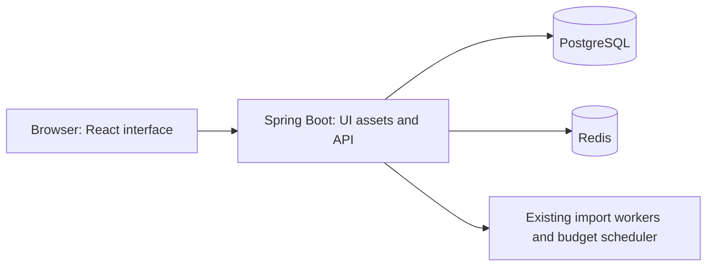

# Approved extension: the SplitNest browser app

Status: **implementation and browser checks complete for milestones 1–5;
packaged delivery verification in progress**.
Scope updated: 19 October 2026 (India).

The original backend, automated checks, documentation and local deployment are
complete. The owner has approved extending the project with a browser interface
to demonstrate the existing real workflows in academic and placement interviews.
This supersedes the original frontend exclusion. Public hosting, paid services
and commercial operation remain outside the scope.

Progress reporting: original backend/local scope **100%**; frontend
extension **5 of 6 milestones complete (83%)**. A combined completion percentage should be based on agreed
acceptance milestones, not an invented estimate. The current status and
milestone gates are maintained in [project-status.md](project-status.md).

Preparation was pushed as `90d459e`. The React app, typed API/error handling,
cookie/CSRF adapter, cross-tab session coordination and feature screens now exist.
Local checks pass: 82 frontend tests and 8 real Chromium workflows. The expanded
Java tests pass (92 cases); final packaging/CI/kind verification is tracked in
[project status](project-status.md). Begin the detailed
[understanding phase](learning-roadmap.md) after the complete app is verified.

## 1. Intended experience

A responsive browser app for flatmates and trip groups:

1. Register and sign in through forms.
2. Create a group and add other already-registered users by email.
3. Add expenses and see the exact stored shares and balances.
4. Upload a CSV/XLSX statement and see actual processing status and row counts.
5. Set category budgets as an admin and view generated alerts.
6. Sign out and handle expired sessions safely.

All operations use the real backend. Buttons and forms replace the manual Swagger
steps; the backend remains responsible for authentication, permissions, money,
transactions, parsing and scheduled work. Swagger remains available for developers.

The interface should be clean, responsive and keyboard accessible, with explicit
loading, empty, success and error states. It should show business information,
not internal token details, database IDs or infrastructure explanations.

## 2. Approved stack and packaging

The owner approved these tools as part of the full-stack extension:

| Tool | Purpose |
|---|---|
| React | Reusable interface components and user interactions |
| TypeScript | Explicit types for forms and API responses |
| Vite | Frontend development server and production asset build |
| React Router | Browser navigation and protected app views |
| Plain CSS | Responsive styling without another UI framework |
| Vitest + React Testing Library | Component and API-interaction tests |
| Playwright | Real-browser end-to-end and multi-tab session tests |
| Node.js 24.22.0 LTS + npm 11.19.1 | Exact build/test tools, pinned with the dependency lockfile |

React documents Vite as an option for an app built from scratch, including its
TypeScript template. This project already has a Java API and does not currently
need a second server framework for rendering pages.
[React guidance](https://react.dev/learn/build-a-react-app-from-scratch).

**Target runtime: one Spring Boot application serving both the compiled
frontend and the API.** Spring Boot supports static assets and an index welcome
page. [Spring Boot static content](https://docs.spring.io/spring-boot/reference/web/servlet.html).

- Packaged build: a Node build stage produces static assets; the Java build
  packages them inside the JAR. The final image contains the JRE and application.
- Local development: Vite proxies `/api` to Spring Boot. Browser requests remain
  on one origin; unrestricted CORS is unnecessary.
- Docker Compose, Kubernetes replicas, probes, HPA, GitOps and monitoring continue
  to manage the existing application image.
- No new Nginx service, ingress, microservice or message broker is needed.
- Tradeoff: frontend and backend releases stay coupled. That is acceptable for
  this project's modular-monolith scope and keeps operations easier to explain.

## 3. Screens tied to real backend capabilities

| Screen | Existing API capability | Acceptance example |
|---|---|---|
| Register / sign in | Register, login, current user | Create an account and reach the signed-in app |
| My groups | List/create groups | Show only the caller's groups |
| Group workspace | Group details/members, expenses and balances | Show members, paginated expenses and current/former balances |
| Add expense | Expense creation and stored splits | Enter `100.00` for three members; display `33.34/33.33/33.33` in the backend's deterministic order |
| Manage members | Admin add/remove | Add an existing user; show role-appropriate controls |
| Statement upload | Upload and GET job status | Show pending/processing/completed/failed and valid/invalid row counts |
| Budgets and alerts | Set/list limits, list alerts | Save a category limit and display actual scheduled alert snapshots |
| Session controls | Refresh and logout | Restore a browser session and sign out safely |

Do not imply capabilities the API does not provide:

- Adding a member is immediate and requires an existing account; it is not an
  invitation-email workflow.
- There is no import-history listing endpoint. Show the current upload job and
  optionally remember its non-secret ID to resume polling.
- Budget responses provide limits and alert snapshots, not a live monthly
  category-spending summary. Do not invent progress charts from one expense page.
- Balances express who owes/is owed; there is no payment processing or settle-up
  workflow.
- INR and equal splits remain the financial rules. The UI formats money and
  validates input but does not recalculate the authoritative splits/balances.

## 4. Browser authentication needs an explicit design

The current API returns access and refresh tokens as JSON for Swagger/API clients.
Its stateless API security disables CSRF and currently protects non-public static
routes. A usable browser session therefore needs more than login forms.

Accepted approach, to be implemented and tested:

1. Keep the existing API authentication contract for Swagger/API clients.
2. Add a small browser-auth adapter over the same authentication/token services.
   Avoid duplicating password verification or refresh-family business rules.
3. Keep the short-lived access token in memory. Put the refresh token in a
   host-only, HttpOnly cookie with deliberate SameSite/path settings. The browser
   adapter must not return that refresh token in its JSON body.
4. Protect cookie-based browser authentication actions with CSRF checks. Keep
   the existing bearer API contract working. Audit origin handling and the
   relationship between browser and JSON endpoints rather than changing global
   security settings casually.
5. Use an explicit localhost HTTP cookie configuration for the local demo.
   Retain a safe HTTPS/Secure configuration for environments that use HTTPS;
   adding that configuration does not include public hosting in this project.
6. Serialize refresh requests within a tab and coordinate across tabs. Existing
   replay detection revokes the whole token family, so parallel refreshes cannot
   be treated as harmless retries. Coordinate sign-out/account changes too.
7. Apply the existing login rate limit to every browser login path; a new route
   must not become a limiter bypass.
8. Permit only the required UI routes/assets. SPA navigation must never convert
   unknown API routes or authorization failures into an HTML success response.

No long-lived authentication tokens in localStorage. Non-secret navigation state
or a job ID is a different kind of data. Frontend build variables and downloaded
JavaScript are public; database passwords and JWT signing keys stay on the server.

Logout clears browser state/cookies and revokes refresh capability. Previously
issued access JWTs still have their existing short expiry; do not promise instant
server-side invalidation that the backend does not implement.

References: [Spring Security SPA CSRF support](https://docs.spring.io/spring-security/reference/servlet/exploits/csrf.html),
[browser cookie attributes](https://developer.mozilla.org/en-US/docs/Web/HTTP/Guides/Cookies).

## 5. Focused execution milestones

| Milestone | Work | Evidence required |
|---|---|---|
| 1. Interface foundation | Pin compatible tool versions; map actual DTO contracts; establish screen layouts, routes and typed API/error handling | Runnable app shell, documented screen flow, route/API tests and verified backend baseline retained |
| 2. Authentication and app shell | Browser-auth adapter, CSRF/cookies, refresh coordination, register/login/logout, navigation | Existing backend tests pass; new cookie/CSRF/rate-limit tests; browser session tests |
| 3. Core expense-sharing experience | Groups, membership, expense creation/deletion/listing and balances | Three users, unequal remainder distribution, zero-sum balances, admin/member/outsider scenarios through the UI |
| 4. Imports and budgets | Actual upload polling, row-count display, limits and alert snapshots | Valid/invalid statement demonstration, job failures, admin-only budget actions, honest daily-alert timing |
| 5. Usability and browser reliability | Responsive layout, accessibility, all interaction states, session expiry, API errors | Component tests and end-to-end tests; multi-tab refresh; safe 400/401/403/404/409/429 handling |
| 6. Package, deliver and document | Frontend build in image, CI checks, source-change promotion, Compose/Kubernetes demonstration | A frontend change reaches the actual deployment; scan/tests pass; complete UI demo and updated learning guides |

The preparation stage is complete before these implementation milestones begin.
Work autonomously across them. Explain major decisions and document progress
without stopping after every component. A milestone counts as complete only when
its acceptance evidence passes; planning or scaffolding alone does not finish it.

## 6. Expected repository changes

This is an implementation inventory, not a promise to create every candidate class name:

- `frontend/`: application source, routes, typed API client, styles, locked
  dependencies and frontend/browser tests. Generated dependencies/build output
  remain ignored.
- `src/main/java/com/splitnest/auth/`: browser-auth adapter and supporting cookie
  configuration using the existing services.
- `src/main/java/com/splitnest/common/`: static-route/security/SPA integration.
- `src/test/`: cookie/CSRF/session/route-boundary and limiter regression tests.
- `Dockerfile`: frontend build stage and packaging of compiled assets.
- `.dockerignore`: explicitly allow necessary frontend source; continue excluding
  `.env`, dependencies, build output and other private/local files.
- `.github/workflows/ci.yml`: locked frontend installation/build, component tests,
  browser tests and dependency checks alongside the existing Java/image gates.
- `scripts/promote-deployment.sh`: include frontend source and lockfiles in the
  application build profile. Without this, a frontend-only change could publish
  an image while GitOps incorrectly preserves the previous UI.
- `scripts/test-promotion.sh`: prove frontend-only changes trigger image promotion
  while documentation-only changes retain the intentional image-preservation rule.
- Documentation and scope instructions: preserve the backend verification record;
  add interface/auth-flow explanations, real UI screenshots, new commands and
  frontend-focused understanding questions after implementation.

Deployment topology need not change for the local web interface. Tests must prove
the UI works from the packaged image, not only from Vite's development server.

## 7. Completion gate for the extended app

The extension is complete when a person can use the actual app through a browser
without manually copying tokens or issuing Swagger requests:

- Register, sign in, recover an expired access session and sign out.
- Create a group; add registered members; enforce roles.
- Create/delete expenses and inspect correct stored shares and updated balances.
- Upload a supported statement, observe real background status/counts and handle
  failed files.
- Save budgets and view existing alerts without implying immediate checks.
- Use the interface at mobile and desktop sizes with accessible forms and clear
  error/loading/empty states.
- Pass existing Java tests plus new security, component and browser tests.
- Run the packaged app with Compose and Kubernetes, with scan gates passing and
  a verified frontend-only GitOps deployment.
- Explain how one click becomes an authenticated API request and database change.

## 8. Free academic demo boundary

The deliverable runs on the owner's machine using the existing Compose and kind
environments. No paid APIs, hosted databases, commercial authentication provider,
domain purchase, cloud cluster or public application deployment is required.
GitHub source, CI and registry continue using the existing authorized setup;
no paid account upgrade or additional service is part of the plan.

Use synthetic demo accounts and statements. The purpose is to demonstrate real
authentication, authorization, financial correctness, background work, testing
and deployment. Local Kubernetes replicas and load experiments are educational
evidence, not a promise of internet-scale capacity or commercial availability.

The existing public source repository and pullable container package distribute
code and images; they do not host a publicly accessible SplitNest application.

## 9. Interview framing

Registration/authentication already exist in the backend. The frontend makes the
real workflow easy to demonstrate. The technical explanation remains how identity,
permissions, transactions, exact arithmetic, background processing, tests and
delivery work together. A login screen by itself is only one visible part.

After the extension is implemented and verified, resume wording can describe a
full-stack expense-sharing web application. Until then, describe the completed
backend and local deployment accurately.

Understanding questions for the extension (leave unanswered):

1. What happens between clicking Sign in and the next authenticated API request?
2. Why are frontend environment variables different from backend secrets?
3. What protects cookie-based refresh/logout from cross-site requests?
4. Why can two browser tabs accidentally trigger refresh-token replay detection?
5. Why must hidden admin buttons be backed by server-side permission checks?
6. Why must a frontend-only commit change the GitOps build profile?
