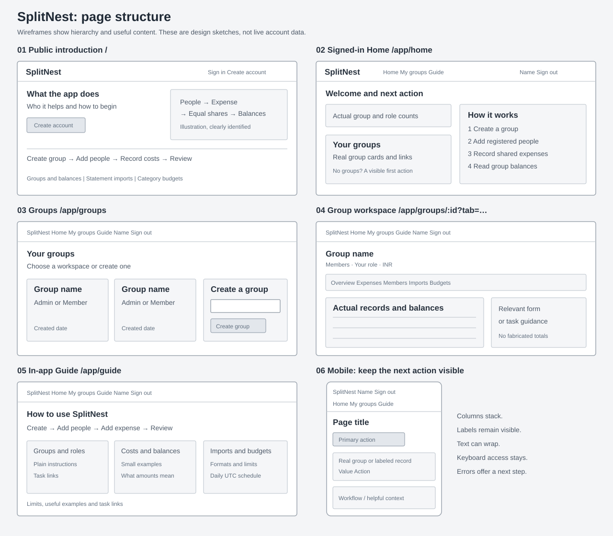

# Interface design and wireframes

SplitNest has two entry points: an introduction for someone who has not signed
in, and a workspace home for someone who has. Groups remain the place where
financial work happens. Home helps a person choose that work; the Guide explains
how to do it.

These low-fidelity wireframes show information hierarchy and navigation. Boxes
represent real sections, rather than final colors, spacing or screenshots.
See the [verification record](evidence/verification.md) for dated checks of the
implemented interface.



## Route map

| Address | Purpose | Access |
|---|---|---|
| `/` | Explain expense sharing, show the workflow and offer account entry | Public |
| `/register` | Create an account | Public |
| `/login` | Sign in or resume an interrupted protected route | Public |
| `/app` | Redirect to the signed-in Home | Signed in |
| `/app/home` | Find groups and choose the next action | Signed in |
| `/app/groups` | Browse groups and create one | Signed in |
| `/app/groups#create-group` | Open the group directory and focus its creation form | Signed in |
| `/app/groups/:groupId` | Group Overview | Current member |
| `/app/groups/:groupId?tab=expenses` | Group expense form and history | Current member |
| `/app/groups/:groupId?tab=members` | Group membership and admin controls | Current member |
| `/app/groups/:groupId?tab=imports` | Statement upload and processing result | Current member |
| `/app/groups/:groupId?tab=budgets` | Category limits and scheduled alert records | Current member |
| `/app/guide` | In-app instructions and feature reference | Signed in |
| `/swagger-ui/index.html` | Explore the API | Public page; protected calls need authentication |

The explicit `?tab=overview` value also selects Overview. A missing or unsupported
tab value falls back to Overview. Section selection belongs in the URL so a
bookmark, refresh, browser Back or Forward returns to the appropriate section.
The backend still authorizes every group request; knowing an address grants no
access.

Opening `/` while signed in redirects to `/app/home`. The top navigation labels
are Home, My groups and Guide.

## 1. Public introduction

```text
+------------------------------------------------------------------+
| SplitNest                                  Sign in  Create account |
+------------------------------------------------------------------+
| What the app does                 | Example expense-sharing flow   |
| Who it is useful for              | People -> expense -> balances  |
| [Create account] [Sign in]         | Clearly identified illustration |
+----------------------------------+-------------------------------+
| Create a group -> Add people -> Record costs -> Review balances    |
+------------------------------------------------------------------+
| Groups and balances | Statement imports | Category budgets         |
| Relevant explanation and limits; no unsupported product promises    |
+------------------------------------------------------------------+
```

The introduction answers “What is this?” before asking for credentials. Its
diagram explains the product without pretending to be a populated account.
Illustrative content is identified as an example. It does not imply payments,
automatic bank access, emailed invitations or live spending forecasts.

## 2. Signed-in Home

```text
+------------------------------------------------------------------+
| SplitNest    Home    Groups    Guide        Account name  Sign out  |
+------------------------------------------------------------------+
| Personal greeting                                                 |
| A short explanation of the next useful action                      |
+------------------------------------------------------------------+
| Your actual group count       | Your actual admin-group count       |
+-------------------------------+----------------------------------+
| Your groups / Choose a group  | How expense sharing works           |
| [Actual group] [Actual group] | 1. Create group  2. Add members     |
| [Open groups / Create group]  | 3. Add expense   4. Read balances   |
+-------------------------------+----------------------------------+
| Task shortcuts explain where to add costs, import or set budgets    |
+------------------------------------------------------------------+
```

Home uses the existing group-list response. Counts describe the returned groups
and roles; they are not estimates of spending or outstanding debt. Financial
figures remain inside each authorized group. This avoids requesting every
group's complete ledger just to render a home screen.

A new account sees a concrete first action and an explanation of the workflow.
An existing account sees actual groups and useful links. The workflow diagram
adds meaning without manufacturing an activity feed or sample transactions.

## 3. Groups

```text
+------------------------------------------------------------------+
| Shared navigation                                                 |
+------------------------------------------------------------------+
| Your groups                       Group count                      |
| What a group contains and how to choose one                         |
+--------------------------------------+---------------------------+
| Existing groups                      | Create a group              |
| [Name, role, created date]           | Name [________________]     |
| [Name, role, created date]           | [Create group]              |
|                                      | What happens next           |
+--------------------------------------+---------------------------+
| No groups? Explain create-or-be-added, with a visible next action    |
+------------------------------------------------------------------+
```

Groups is a directory and creation screen. The creation form remains usable
without a second confirmation page. An admin adds an existing registered person
by email inside Members; the interface explains that requirement before it can
be mistaken for an invitation system.

## 4. Group workspace

```text
+------------------------------------------------------------------+
| Shared navigation                                                 |
+------------------------------------------------------------------+
| All groups / Group name                 Members, role, INR          |
+------------------------------------------------------------------+
| Overview | Expenses | Members | Imports | Budgets                    |
+------------------------------------------------------------------+
| Section context: what this view contains and the next useful action |
+--------------------------------------+---------------------------+
| Real records / balance table         | Relevant form or guidance   |
| Server-owned amounts and history     | Existing permitted action   |
|                                      |                             |
+--------------------------------------+---------------------------+
```

Each section has a distinct job. Overview explains paid/share/net balances;
Expenses records and lists costs; Members manages access; Imports handles bulk
entry; Budgets shows recurring category limits and saved alert snapshots.
URL-addressable tabs preserve this hierarchy without five duplicate workspaces.

The group name and role provide context once. Helper content explains the
current task instead of repeating the page heading. Amounts, membership,
permissions, stored shares and import outcomes come from the API.

## 5. In-app Guide

```text
+------------------------------------------------------------------+
| Shared navigation                                                 |
+------------------------------------------------------------------+
| How to use SplitNest                                               |
| Short starting sequence                                            |
+------------------------------------------------------------------+
| Create group -> Add people -> Add expense -> Review balances        |
+---------------------+---------------------+----------------------+
| Groups and roles    | Expenses / balances | Imports / budgets     |
| Plain instructions  | Small example       | Formats and schedules |
+---------------------+---------------------+----------------------+
| Limits, useful examples and links back to actual work                |
+------------------------------------------------------------------+
```

The Guide is available where the work happens. The repository's
[user guide](user-guide.md) remains the complete printable manual. The in-app
version explains everyday tasks without exposing infrastructure or interview
notes in the product.

## Mobile hierarchy

```text
+-----------------------------+
| SplitNest   Account Sign out |
| Home      Groups      Guide  |
+-----------------------------+
| Page title and next action   |
| [Primary action]             |
+-----------------------------+
| Real group / record card     |
| Label: value                 |
| Label: value      [Action]   |
+-----------------------------+
| Workflow / helpful context   |
| One step per readable row    |
+-----------------------------+
```

Columns stack in reading order. Text and account names wrap instead of forcing
the entire page sideways. Expense/member rows become labeled cards on narrow
screens. Group section tabs remain available; decorative diagrams must fit their
container and never push actions off screen.

## Empty, loading and error states

| Situation | Useful response |
|---|---|
| Session restoring | Explain that the session is being restored before rendering account data |
| Groups loading | A loading message; unknown counts must not appear as zero |
| No groups | Explain create-or-be-added and link to group creation |
| No expenses | Explain that balances need saved expenses and point to the expense form |
| No import yet | Show required columns, the sample download and upload action |
| No budgets or alerts | Explain admin ownership and the daily UTC check |
| API request fails | Show the actual safe error and a relevant retry action |
| Group access is lost | Show the unavailable-group result and a route back to the group list |

Useful space can contain a workflow, an explanation or a task link. It should
not contain invented charts, repeated headings, random slogans or fake account
activity. A failed request is not an empty account.

## Accessibility and implementation boundaries

- Shared navigation identifies the active page. A skip link reaches the main
  content, and forms have explicit labels and connected error messages.
- Group tabs retain their tab/tabpanel semantics, roving keyboard focus, arrow
  keys and Home/End behavior while also updating the URL.
- Diagrams have text equivalents. Decorative shapes do not interrupt screen
  readers, and guidance remains readable without color alone.
- All views use the existing React Router, plain CSS and local SVG assets.
  No dashboard service, UI framework or production Node server is introduced.
- Public introduction and signed-in navigation are presentation additions. The
  financial, authentication and authorization contracts stay in the Java API.

Component and browser checks should cover public entry, signed-in entry,
zero/loaded/error groups, protected routes, deep links, browser history and
phone/tablet/desktop layouts. Delivery observations belong in the dated evidence
record rather than being inferred from this design document.
